<div align="center">
  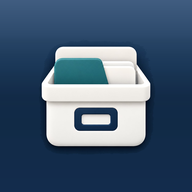

  # Markitem App

  **本地优先的私人数字物品档案馆**

  记录值得长期留存的设备与日常器物，管理分类标签、购买投入、日均持有成本、保修周期与物品生命周期。

  [](https://github.com/HrrY1n/item-storage-app/actions/workflows/ci.yml)

  `Local-first PWA` · `React 19` · `TypeScript` · `Dexie / IndexedDB` · `Cloudflare Workers & D1`
</div>

---

## 项目简介

**Markitem App** 是一个面向个人日常使用的数字物品管理渐进式 Web 应用（PWA）。它围绕“较昂贵的数码设备，以及有纪念意义或值得长期追踪的日常物件”设计，不设注册登录与多用户账号体系，打开浏览器或安装到手机主屏幕即可离线使用。

- **Local-first 本地优先**：新增、编辑与删除首先写入当前设备浏览器的 IndexedDB，无后端亦可完整运行。
- **PWA 离线可用**：预缓存应用壳与全部内置图标资源，支持添加至主屏幕、离线冷启动及深链访问。
- **立体图标与多维分类**：内置 **220 枚**浅深色共用的透明立体 WebP 图标，默认提供 **7 个一级、49 个二级**物品分类及自由标签检索。
- **投入与日均成本核算**：以整数分精度记录购买价格、附加花费与转售回收金额，自动计算总投入、实际持有成本与日均成本。
- **保修周期与临期提醒**：支持按自然月或指定日期记录保修，保留 12 段点阵进度条与首页 30 天内到期提醒。
- **AI 辅助录入（可选）**：在已配对并配置 Cloudflare Workers AI 的环境下，支持从单张物品照片或订单截图提取候选字段，经人工核对后填入草稿。
- **ZIP 备份与私人同步（可选）**：支持本地校验式 ZIP 导出与恢复，以及基于自持恢复码的单用户跨设备云同步。

---

## 产品界面展示

以下界面均直接采集自当前代码树运行实例，运行于隔离测试浏览器并使用合成示例数据，不包含任何真实个人物品或隐私信息（[查看采集记录与校验值](docs/screenshots/current/capture-results.json)）。

### 移动端核心视图（浅色 / 深色）

<table>
  <tr>
    <td width="33%" align="center">
      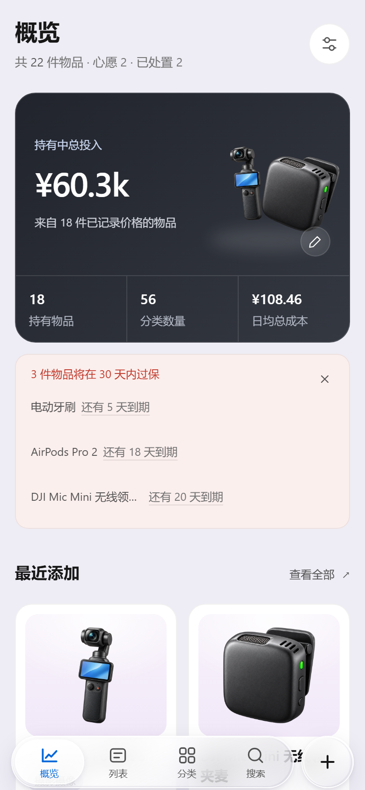
      <br />
      <sub><b>概览（浅色）</b>：总投入、自选展示器物、临期保修提醒与悬浮毛玻璃底栏</sub>
    </td>
    <td width="33%" align="center">
      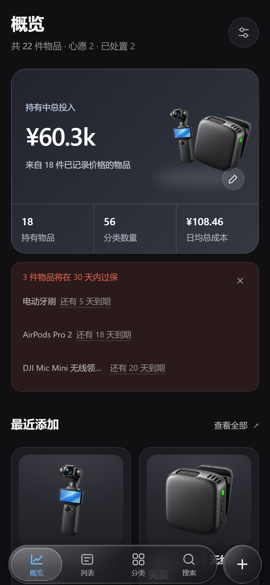
      <br />
      <sub><b>概览（深色）</b>：浅深色共用同一套透明立体图标与阅读层级</sub>
    </td>
    <td width="33%" align="center">
      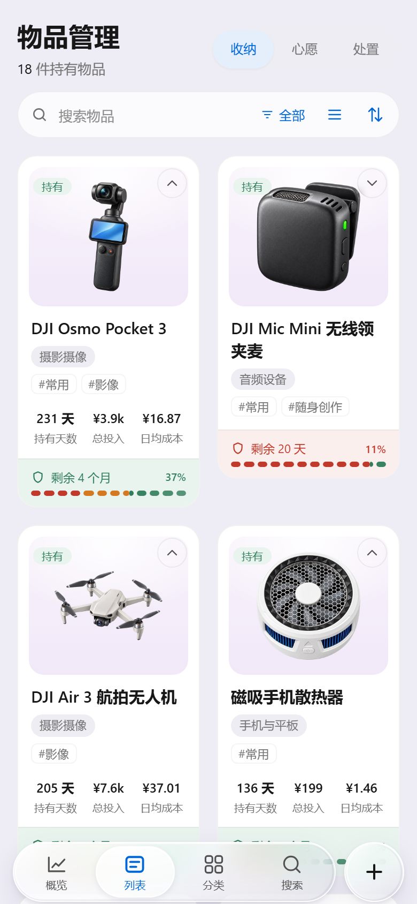
      <br />
      <sub><b>物品列表</b>：卡片成本明细支持逐卡独立收折，12 段点阵保修条始终可见</sub>
    </td>
  </tr>
</table>

### 详情面板、新增编辑与图标选择

<table>
  <tr>
    <td width="33%" align="center">
      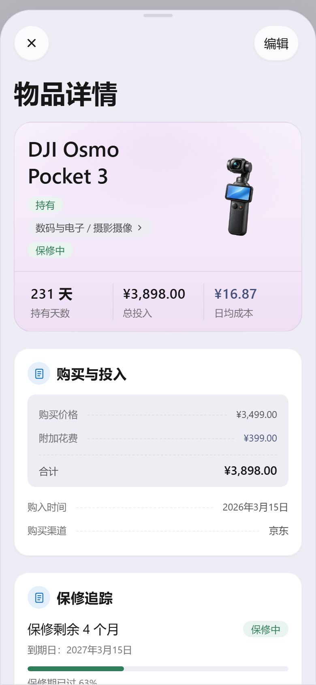
      <br />
      <sub><b>物品详情</b>：在原列表上方打开抽屉面板，集中呈现购买与投入、保修及标签</sub>
    </td>
    <td width="33%" align="center">
      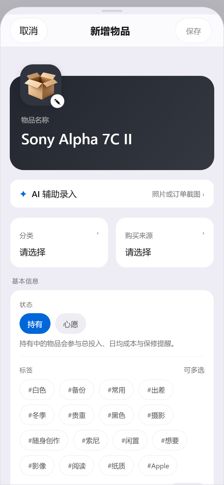
      <br />
      <sub><b>新增与编辑</b>：支持更换封面图标、AI 照片/订单识别入口与未保存防误退保护</sub>
    </td>
    <td width="33%" align="center">
      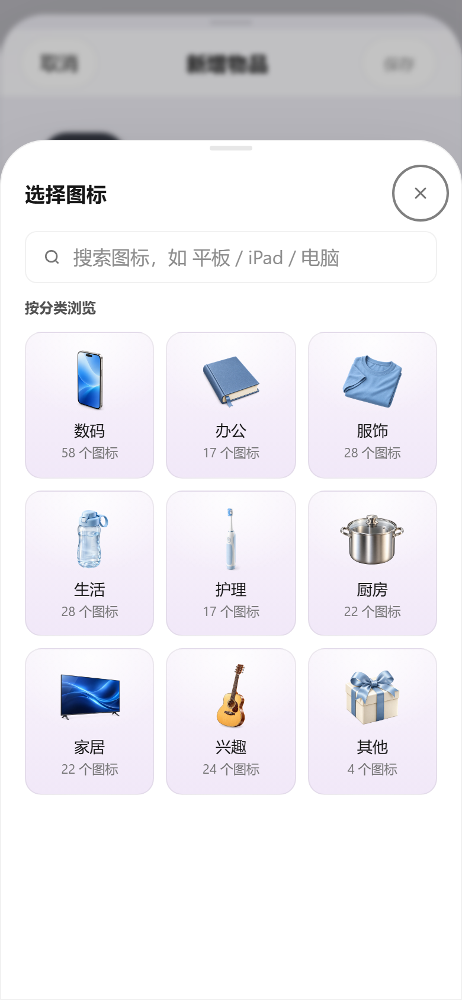
      <br />
      <sub><b>图标选择器</b>：九类素材分组、最近使用记录与中英文别名检索</sub>
    </td>
  </tr>
</table>

<a id="保修录入"></a>

### 分类体系、保修管理与生命周期流转

<table>
  <tr>
    <td width="33%" align="center">
      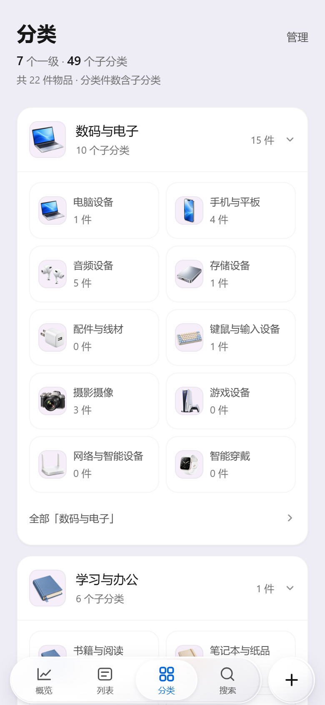
      <br />
      <sub><b>分类总览</b>：7 个一级分类与 49 个子分类，实时统计各层级物品件数</sub>
    </td>
    <td width="33%" align="center">
      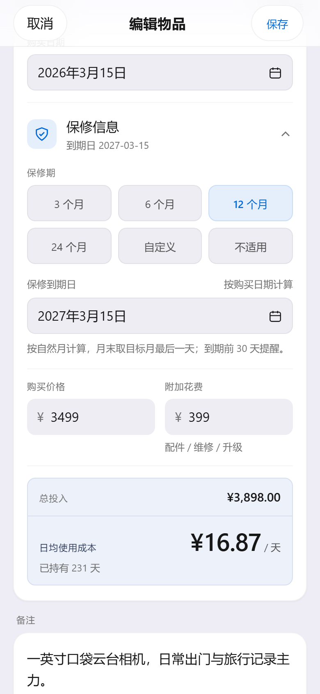
      <br />
      <sub><b>保修设置</b>：按 3 / 6 / 12 / 24 个月或自定义整月自动推算到期日</sub>
    </td>
    <td width="33%" align="center">
      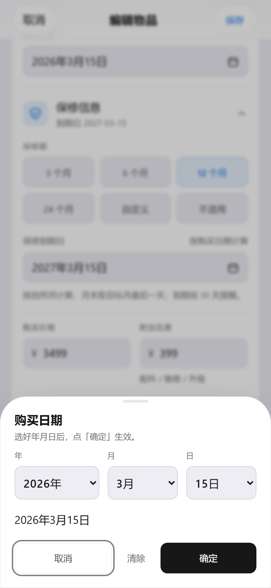
      <br />
      <sub><b>日期确认弹层</b>：年月日滚动选择先改草稿，点击「确定」后才写入表单</sub>
    </td>
  </tr>
  <tr>
    <td width="33%" align="center">
      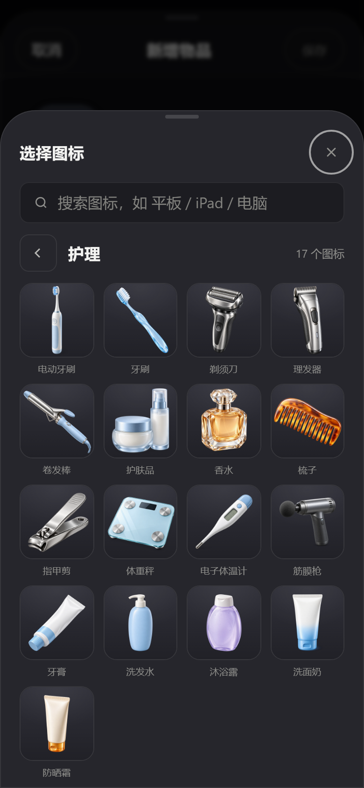
      <br />
      <sub><b>深色图标网格</b>：768×768 透明通道立体素材在深色背景下的精细呈现</sub>
    </td>
    <td width="33%" align="center">
      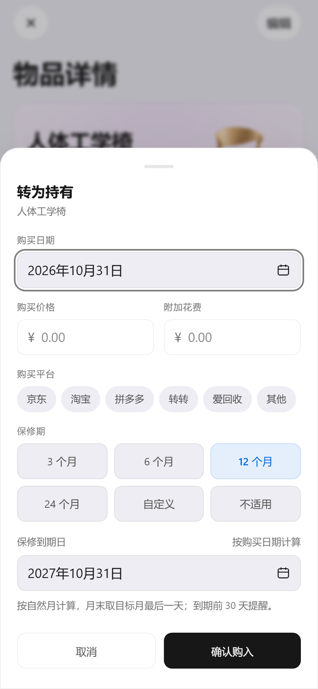
      <br />
      <sub><b>心愿转为持有</b>：购入后就地补齐价格、日期与保修，无需重建档案</sub>
    </td>
    <td width="33%" align="center">
      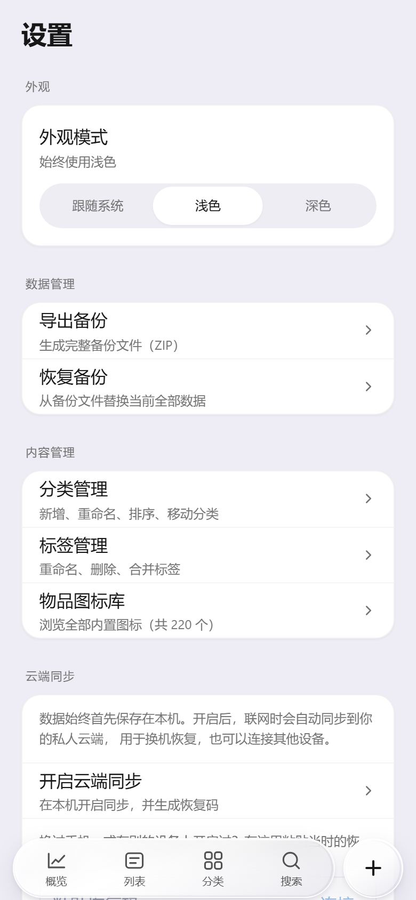
      <br />
      <sub><b>设置中心</b>：主题切换、ZIP 备份恢复、分类/标签/图标管理与可选同步</sub>
    </td>
  </tr>
</table>

> 更多深色保修预览见 [深色保修设置](docs/screenshots/current/13-warranty-months-dark.png)；完整内置素材可查看 [220 枚图标总览图](assets/item-icons/overview.webp)。

### 桌面宽屏自适应布局

在桌面视口下，应用自动切换为常驻侧边导航栏、宽屏概览洞察与左右双栏详情布局：

<table>
  <tr>
    <td width="50%" align="center">
      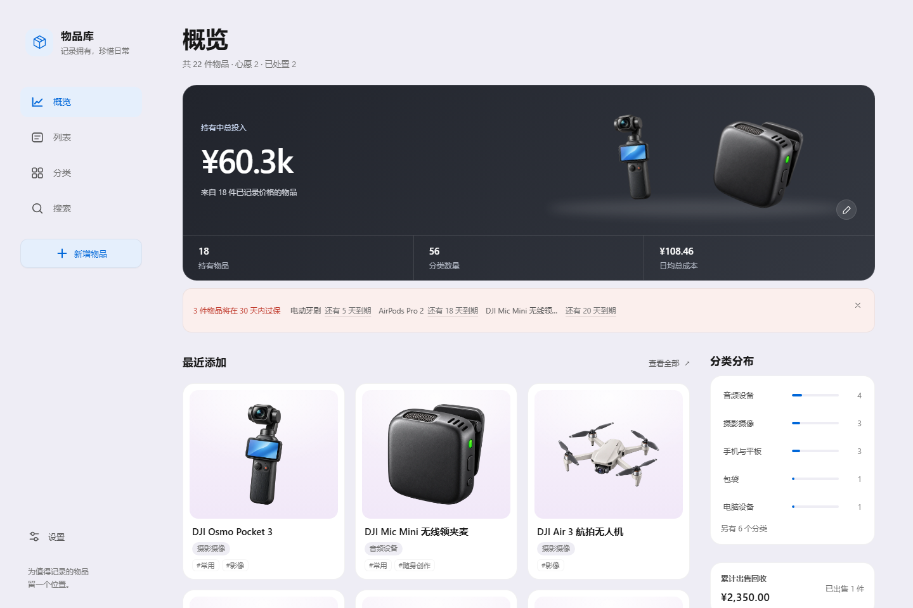
      <br />
      <sub><b>桌面概览（浅色）</b>：常驻侧栏导航，并排展示最近添加与分类占比洞察</sub>
    </td>
    <td width="50%" align="center">
      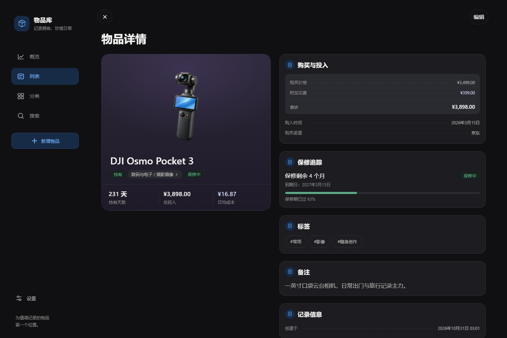
      <br />
      <sub><b>桌面详情（深色）</b>：左侧展示器物图像与核心指标，右侧呈现投入明细与保修记录</sub>
    </td>
  </tr>
</table>

---

## 核心功能

### 1. 快速建档与 220 枚内置立体图标
- 记录物品名称、分类、多选标签、备注、状态及可选的购买与保修信息。
- 内置 **220 枚**统一光影风格的透明背景立体图标（按数码、办公、服饰、生活、护理、厨房、家居、兴趣、其他九组整理），支持 `电脑`、`iPad`、`Pocket`、`Mic Mini`、`散热背夹` 等日常称呼检索与最近使用记忆（详见 [图标资源说明](assets/item-icons/README.md)）。
- 站内打开详情与新增/编辑共用可下拉手势关闭的抽屉面板，自动锁定底层滚动并在关闭后恢复列表位置；表单存在未保存草稿时，对站内跳转、浏览器返回与整页刷新均提供防丢失确认。

### 2. 多维分类树与会话级检索过滤
- 默认内置 **7 个一级分类、49 个二级子分类**，旧版本升级时自动增量补齐且不覆盖用户已改名或删除的分类（详见 [分类说明](docs/categories.md)）。
- 物品列表支持按状态（收纳 / 心愿 / 处置）、分类芯片、关键词（匹配名称、备注与标签）组合筛选，提供最近添加、名称、总投入、日均成本四种排序及**网格 / 列表**双视图切换，并在当前浏览器会话内自动保留筛选状态。

### 3. 购买投入与日均持有成本追踪
- 金额统一以**整数分**存储与运算，避免浮点误差；概览与卡片对满千元金额自动采用简洁 `k` 显示（如 `¥1.6k`），详情页与编辑页始终展示精确金额。
- 严格区分**总投入**（购买价 + 附加花费）与已出售物品的**实际持有成本**（总投入 − 出售回收金额）及转手盈亏；持有天数按含购买当天的日历日计算，物品处置后自动冻结在处置日。

### 4. 按月保修推算与临期提醒
- 新增物品与心愿转持有默认选中 **12 个月**保修，支持一键切换 `3 / 6 / 12 / 24 个月`、自定义整月（月末日期自动安全夹紧，支持闰年二月）、单独指定到期日或设为「不适用」。
- 首页自动汇总 **30 天内即将过保**的持有物品提醒，支持按物品与到期日关闭提醒；列表卡片在收起与展开状态下均保留 12 段红橙绿点阵保修进度条。

### 5. 完整物品生命周期流转
- 支持 **心愿 → 持有 → 已处置** 全周期管理，处置方式区分「出售」「丢弃」与「其他」。
- 心愿物品无需填写购买价格且不计入总投入，购入后可在详情页就地「转为持有」；已处置物品可随时恢复为持有状态并完整保留原有购买记录。

### 6. AI 图片辅助录入（需配对与后端资源）
- 在新增或编辑面板中支持选择单张物品照片或电商订单截图：浏览器端先将图片长边缩放至 1600px 内并重编码为 ≤400 KiB 的 JPEG；遇到高宽比超过 3.5 的长截图时，要求先在本机框选局部区域再上传，确保文字清晰可读。
- 后端固定调用 Cloudflare Workers AI 视觉模型 `@cf/qwen/qwen3.8-27b` 提取候选名称、匹配现有唯一末级分类及订单价格/日期/渠道。
- **使用前提与安全边界**：该功能并非开箱无限免费能力，需设备已完成云端空间配对、服务端已配置 `AI` 绑定且开启 `AI_FREE_PLAN_CONFIRMED="true"`，并受部署账号的 Workers Free 每日免费额度限制。识别结果仅作为可编辑候选供用户勾选填入表单（已有非空字段默认不覆盖），**不会自动保存物品**；原图不写入数据库、ZIP 备份或日志（详见 [AI 识别说明](docs/ai-recognition.md)）。

### 7. 校验式本地 ZIP 备份与恢复
- 在浏览器本地使用按需加载的 `JSZip` 打包导出完整业务数据（`manifest.json` + `data.json` 及资产记录）。
- 恢复备份前先执行格式校验、历史备份版本迁移与分类循环引用阻断检查，展示备份摘要并经用户二次确认后，才在单个 IndexedDB 事务内完成原子替换。

### 8. 可选单用户跨设备云同步
- 默认关闭，开启后通过应用生成的随机密钥与自持**恢复码**连接自行部署的 Cloudflare Worker + D1 同步空间（服务端仅存储密钥哈希）。
- 采用 `Local-first + Outbox` 离队确认机制、严格递增 `revision` 分页拉取与 `sessionEpoch` 会话栅栏：网络离线或推送失败只保留待同步队列，绝不回滚本机已保存的修改。

### 9. PWA 离线冷启动与无感安全更新
- 支持 iOS Safari「添加到主屏幕」及桌面浏览器独立窗口安装；针对静态资产路由优化了根路径 `/` App Shell 预缓存，离线冷启动及直接打开 `/items`、`/categories`、`/settings` 等深链均可正常渲染。
- 支持在设置页手动检查更新及后台检测新版本；若用户正处于表单编辑或弹层操作中，更新会自动挂起并提示「新版本已就绪」，待保存或退出编辑后再平滑刷新并恢复原滚动位置。

---

## 技术架构

### 技术栈

| 层级 | 采用技术 | 实际用途 |
|---|---|---|
| 前端视图与路由 | React 19、TypeScript 5.9、React Router 7 | 页面与抽屉面板路由编排、未保存表单离开拦截（`useBlocker`） |
| 构建与样式 | Vite 7、Tailwind CSS 3.4 | 前端打包、浅深色主题语义 Token 与响应式布局 |
| 本地持久化 | Dexie 4（IndexedDB） | 本地唯一业务数据源、多表原子事务、响应式实时查询（`useLiveQuery`） |
| 离线与备份 | `vite-plugin-pwa`（Workbox）、`JSZip` | 379 项静态资源预缓存、平滑更新过渡、按需加载的本地 ZIP 备份编解码 |
| 可选云端服务 | Cloudflare Workers、Cloudflare D1、Workers AI | 静态资产托管 + `/api/sync/*` 增量同步镜像 + `/api/ai/recognize` 视觉辅助识别 |
| 质量与测试 | Vitest 5、`fake-indexeddb`、`node:sqlite`、CDP 浏览器套件 | 单元/集成测试、真实 SQLite D1 迁移与触发器契约验证、隔离 Edge 端到端回归 |

### 数据流与运行边界

```text
┌─────────────────────────────────────────────────────────────────────────┐
│ 浏览器端 / PWA（Local-first 默认独立闭环）                              │
│                                                                         │
│  React Pages & Sheets                                                   │
│         │                                                               │
│         ▼                                                               │
│  Feature Hooks / Services (纯领域规则计算 · ZIP 备份恢复 · PWA 更新守卫) │
│         │                                                               │
│         ▼                                                               │
│  Dexie Repositories ──(单事务原子写入)──► IndexedDB (业务表 + syncQueue)│
└───────────────────────────────────────────────────┬─────────────────────┘
                                                    │
                         （仅当用户开启云同步或主动调用 AI 辅助录入时联网）
                                                    │
                                                    ▼
┌─────────────────────────────────────────────────────────────────────────┐
│ Cloudflare Workers（同源部署，/api/* 路由优先，其余走 SPA 静态资产）     │
│                                                                         │
│  • POST /api/sync/push & GET /api/sync/pull ──► Cloudflare D1 (镜像库)  │
│  • POST /api/ai/recognize                   ──► Workers AI (视觉模型)   │
└─────────────────────────────────────────────────────────────────────────┘
```

各契约版本相互独立演进：当前应用版本为 `0.1.0`，IndexedDB（Dexie）Schema 为 `v4`，ZIP 备份契约为 `v3`，云同步通信协议为 `v2`。详细分层约束与同步状态机见 [架构与维护入口](docs/architecture.md)。

---

## 本地运行与测试

### 环境要求

- **Node.js `22.x`**（推荐至少 `22.12`，GitHub Actions CI 运行于 Node.js `22`；本地亦兼容 Node.js `24.x`，Worker 集成测试依赖 Node 内置 `node:sqlite`）。
- 仅本地开发与使用应用时，**不需要**配置 Cloudflare 账号、环境变量或数据库连接。

### 启动开发服务器

```bash
npm ci
npm run dev
```

按终端输出打开本地地址（默认 `http://localhost:5173`）即可体验完整本地功能。

### 常用工程与验证命令

```bash
# TypeScript 全量工程类型检查（App + Node + Worker）
npm run typecheck

# 运行单元与集成测试（含 Dexie 仓储、同步引擎与 SQLite D1 契约测试）
npm test

# 构建生产包与 Service Worker 预缓存清单（输出至 dist/）
npm run build

# 本地预览生产构建产物
npm run preview
```

需要运行基于隔离 Edge Profile 的端到端浏览器与离线 PWA 验证脚本（如 `verify.mjs`、`npm run verify:icons`、`npm run verify:warranty`、`npm run verify:pwa-offline`、`npm run verify:pwa-update`）时，请务必先阅读 [AGENTS.md](AGENTS.md) 与 [BROWSER_TESTING.md](BROWSER_TESTING.md)，严格通过 `npm run browser:start` / `npm run browser:stop` 管理项目级 `.tmp/` 测试浏览器实例。

---

## 部署说明

本项目基于单个 Cloudflare Worker 同时托管前端静态资产（Static Assets，启用 SPA 回落）与 `/api/*` 后端接口，配置文件位于 [`wrangler.jsonc`](wrangler.jsonc)。实际使用可分为四种运行与发布模式：

### 1. 纯本地开发或静态体验
直接执行 `npm run dev` 或 `npm run build && npm run preview`。同步与 AI 接口在无 Worker 环境下保持禁用，不影响本地物品建档、统计、保修与 ZIP 备份恢复。

### 2. Cloudflare Preview（安全隔离预览）
用于在不触碰正式数据的前提下验收前端界面、路由与 PWA 离线缓存：

```bash
npx wrangler preview
```

仓库已在 `wrangler.jsonc` 的 `previews` 字段中默认配置 `SYNC_DISABLED="true"` 与空 `d1_databases` 列表：预览环境**不绑定生产 D1 数据库**，访问同步接口会明确返回 `HTTP 503`。若需在预览中测试云同步，请先创建独立的测试 D1 数据库并按序执行迁移，切勿将生产 `database_id` 填入预览配置。

### 3. Cloudflare 正式生产部署
个人自建生产环境时，需在自有 Cloudflare 账号下准备对应资源：

1. **创建并初始化 D1 数据库**：在 Cloudflare 控制台创建 D1 数据库（如 `item-sync`），将其 `database_id` 填入 `wrangler.jsonc` 顶层 `d1_databases`（绑定名必须保持为 `SYNC_DB`），并在该数据库的 Console 中按文件名顺序执行 `worker/migrations/*.sql`。
2. **核对 AI 绑定与免费额度开关（可选）**：`wrangler.jsonc` 默认声明 `ai.binding = "AI"`。请仅在确认部署账号处于 **Workers Free** 计划（额度耗尽即停，不产生超额账单）后再将 `vars.AI_FREE_PLAN_CONFIRMED` 设为 `"true"`；若使用 Paid 计划或无需 AI 录入，请将其设为 `"false"`。
3. **构建并发布**：
   ```bash
   npx wrangler deploy
   ```
   `wrangler.jsonc` 中的 `build.command` 会在上传前自动执行 `npm run build`。

### 4. GitHub 连接自动部署（Workers Builds）
将 Cloudflare Workers Builds 连接至 GitHub 仓库后：
- 推送至生产分支（`main`）时，Cloudflare 自动执行构建命令 `npm run build` 与部署命令 `npx wrangler deploy` 发布正式版本。
- 非生产分支构建使用预览命令 `npx wrangler preview` 生成隔离预览地址。
- 注意：代码提交到 GitHub 或 CI 通过并不代表线上站点已更新；应用设置页内的「检查更新」检测的是当前站点实际已生效的 Worker 部署版本。

---

## 数据与隐私说明

- **本地存储与数据持久化**：所有物品、分类、标签默认存储在当前设备浏览器的 IndexedDB 中。尽管应用启动时会尽力向浏览器请求持久化存储权限（`navigator.storage.persist`），但清空浏览器网站数据、卸载主屏幕应用或设备损坏仍会导致本机未备份数据丢失。**日常使用请定期通过「设置 → 导出备份」保存最新 ZIP 备份。**
- **ZIP 备份范围**：ZIP 备份完全在本地生成与校验，包含业务记录及内置/本地资产映射，但**不会导出**云同步恢复码或连接凭据。
- **云端同步与恢复码保管**：云同步为可选镜像机制，不能替代定期离线 ZIP 备份。开启同步后生成的**恢复码**包含访问该同步空间的完整密钥信息，服务端仅保存其哈希值且不提供找回机制——请像保管密码一样离线保存恢复码，切勿将其提交至 Git、放入公开截图或发送给他人。关闭云同步不会删除当前设备上的本地物品数据。
- **AI 识别的数据传输边界**：未配对设备选择图片不会发起任何上传。在已配对设备上手动点击「开始识别」时，本机压缩或裁剪后的单张 JPEG 图片及当前末级分类名称会发送至你所配置的 Cloudflare Worker 与 Workers AI 模型进行推理；图片本身不存入应用数据库、ZIP 备份或服务端日志，返回的候选字段必须由你手动勾选并点击「保存」后才会写入本机数据库。

---

## 项目状态、文档索引与版权说明

### 当前状态与定位
- **产品版本**：`0.1.0`（见 [`package.json`](package.json) 与 [`src/appInfo.ts`](src/appInfo.ts)，对应初始快照标签 [`v0.1.0`](https://github.com/HrrY1n/item-storage-app/tree/v0.1.0)，`main` 分支持续维护更新）。
- **适用范围**：定位为轻量、低维护成本的个人自用数字物品库。根据 [产品目标](docs/product-goals.md)，本项目长期不追求多用户账号注册、家庭多人协作、企业库存/进销存或房间柜格位置树。

### 延伸文档导航

| 文档 | 内容说明 |
|---|---|
| [文档总目录](docs/README.md) | 仓库全部设计、架构、审计与验收文档的统一入口 |
| [产品目标与非目标](docs/product-goals.md) | 记录范围、核心交互偏好与长期不做的边界 |
| [架构与维护入口](docs/architecture.md) | 目录分层、四项独立版本契约、同步状态机与财务计算口径 |
| [物品分类说明](docs/categories.md) | 7 个一级与 49 个二级默认分类表及旧库增量升级规则 |
| [AI 辅助录入说明](docs/ai-recognition.md) | 模型绑定、免费额度保护开关、本地长图裁剪与校验边界 |
| [图标库资源说明](assets/item-icons/README.md) | 220 枚透明立体 WebP 图标规范、别名检索与生成记录 |
| [图标库与真机更新验收](docs/icon-library-v2-audit.md) | 图标库 2.0 审计、PWA 更新验证及 iPhone 真机验收步骤 |
| [动效集成与复测工具](deliverables/motion-integration-final/INTEGRATION_RESULT.md) | 面板入场/手势集成结论，配套复测工具见 [MotionLab](tools/motion-lab/README.md) |
| [浏览器测试规范](BROWSER_TESTING.md) | 隔离 Edge Profile 启动方式与全套端到端回归脚本说明 |
| [工程与安全约束](AGENTS.md) | 提交前最低检查项、本地数据保护与工作区卫生规范 |
| [仓库治理记录](docs/REPOSITORY_GOVERNANCE.md) | 仓库文件保留边界、忽略规则与历史整理记录 |

### 版权与许可说明
本仓库代码公开以便查阅与技术交流，但仓库当前未附带开源许可证（无 `LICENSE` 文件）。未经作者明确书面授权，保留所有权利（All Rights Reserved）。
