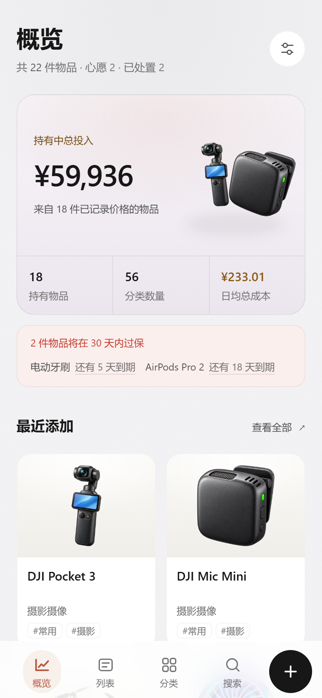
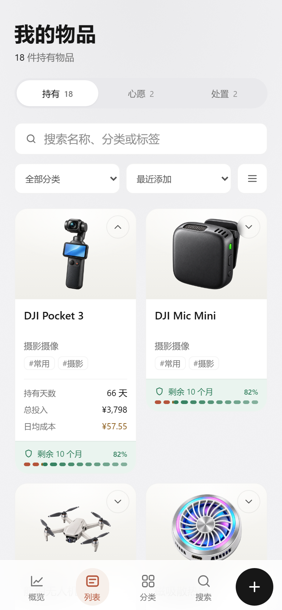
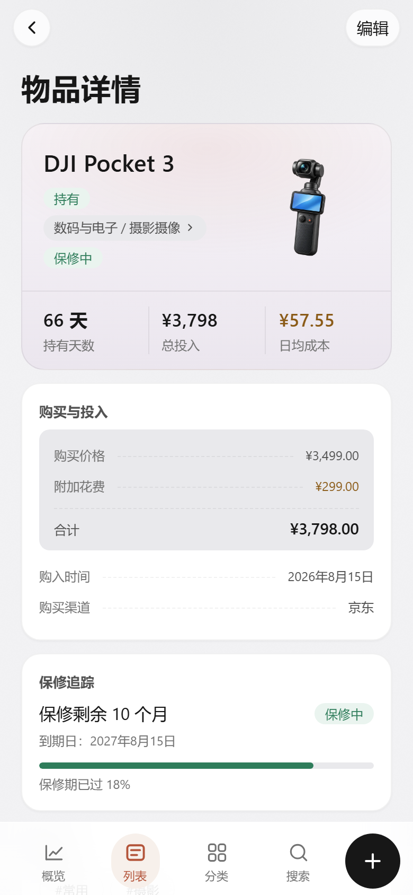
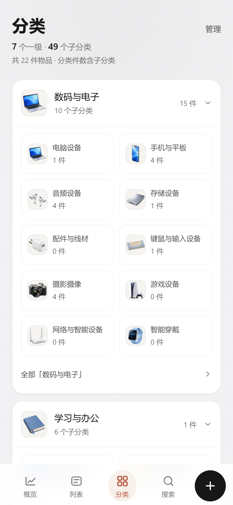
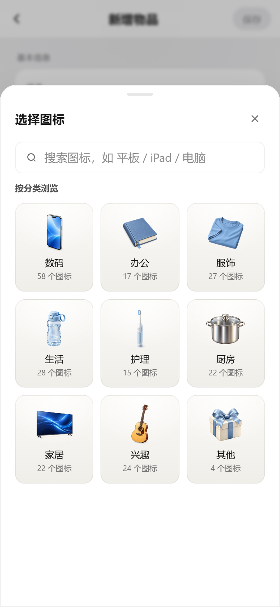
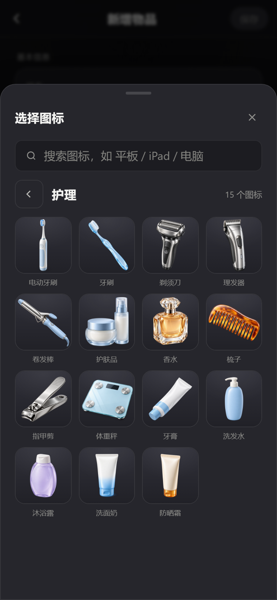
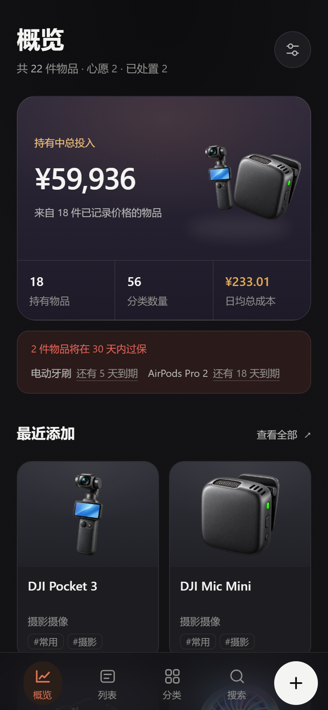
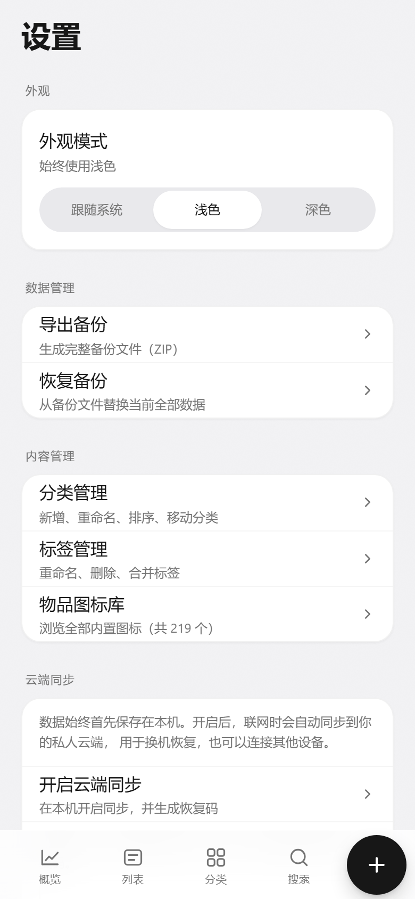
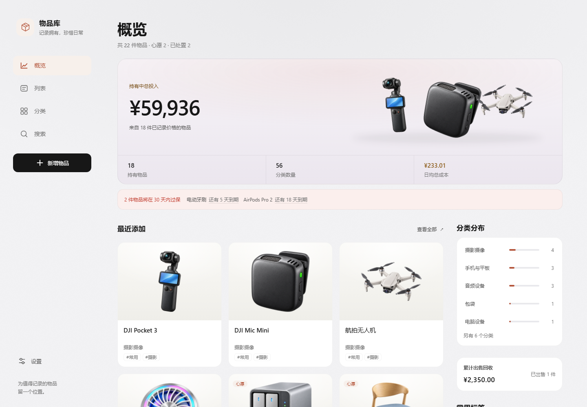
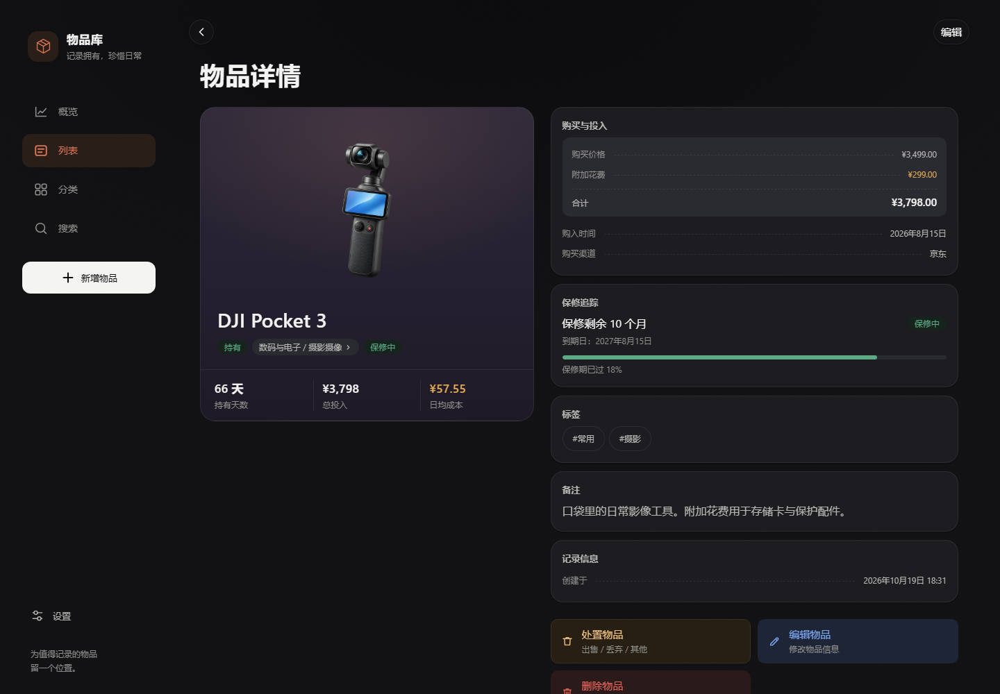

# Private Item Library

当前版本：`0.1.0`。

一个本地优先的个人物品管理 PWA，用来记录、整理和追踪自己的物品。
它支持分类、标签、搜索、购买与持有成本、保修和物品生命周期管理，并可在手机或桌面浏览器中离线使用。
数据默认保存在当前设备；云端同步是可选能力，不影响本地使用。优先记录较昂贵的设备和有意思、值得长期追踪的小物件，图标按实际需要取舍。

## 主要功能

- 物品记录：名称、图标、备注、分类与标签；支持搜索、组合筛选、排序，以及网格和列表视图切换。
- 图标库：217 个透明立体图标，支持九类浏览、中英文及别名搜索、最近使用和单击选择，浅色与深色主题共用。
- 分类与标签：默认 7 个一级、49 个二级分类，分类页显示真实子分类、图标与物品数量；支持自定义分类和标签。
- 生命周期：支持「心愿 → 持有 → 已处置」，处置方式包括出售、丢弃和其他。
- 购买与持有成本：记录购买日期、购买价格、附加花费和购买平台，计算总投入、实际持有成本与日均成本；网格卡片的成本明细可独立展开、收起。
- 保修追踪：默认 12 个月，可选 3 / 6 / 12 / 24 个月、自定义整月或不适用；卡片始终保留点阵、剩余时间与百分比，进度不可计算时只显示到期信息。
- 备份恢复：导出和恢复经过校验的 ZIP 备份，包含业务数据及用户资产。
- 可选云同步：通过恢复码连接同步空间，在设备之间同步或恢复数据。
- PWA 与响应式界面：支持安装到主屏幕和离线使用；手机采用底部导航，桌面采用侧栏、宽屏概览和详情分栏，支持浅色、深色及跟随系统。
- 更新检查：发现已部署的新版本后安全更新；编辑期间保留输入，完成操作后再刷新。

## 界面预览

以下截图于 **2026-10-19** 从当前 `0.1.0` 界面重新采集，全部使用隔离浏览器中的示例数据。移动端视口为 390×844，以 2 倍像素密度截图；桌面视口为 1440×1000。截图展示当前的 217 个内置图标与 7 个一级、49 个二级分类。

### 手机界面

<table>
  <tr>
    <td width="50%"></td>
    <td width="50%"></td>
  </tr>
  <tr>
    <td align="center"><sub>概览：总投入、实物图标、保修提醒与最近添加</sub></td>
    <td align="center"><sub>物品：独立展开成本明细，点阵保修始终可见</sub></td>
  </tr>
  <tr>
    <td></td>
    <td></td>
  </tr>
  <tr>
    <td align="center"><sub>物品详情：购买信息、成本和保修追踪</sub></td>
    <td align="center"><sub>分类：展开二级分类，查看图标和实际件数</sub></td>
  </tr>
  <tr>
    <td></td>
    <td></td>
  </tr>
  <tr>
    <td align="center"><sub>图标选择：九类素材、三列分类卡片与全局搜索</sub></td>
    <td align="center"><sub>分类详情：四列图标网格，浅深色共用透明资源</sub></td>
  </tr>
  <tr>
    <td></td>
    <td></td>
  </tr>
  <tr>
    <td align="center"><sub>深色概览：同一套透明素材与清晰的阅读层级</sub></td>
    <td align="center"><sub>设置：外观、备份、分类、标签与图标库</sub></td>
  </tr>
</table>

### 桌面界面

宽屏概览使用常驻侧栏，将最近添加与分类分布、回收金额等物品洞察并排展示。



物品详情将实物图标和持有指标置于左侧，购买信息、保修、标签与备注置于右侧；下图为深色主题。



[截图采集记录](docs/screenshots/current/capture-results.json)包含来源提交、浏览器、视口、示例数据说明与图片校验值。

### 图标库 2.0

九类为数码、办公、服饰、生活、护理、厨房、家居、兴趣和其他，与用户自行管理的物品分类独立。支持「电脑」「笔记本」「iPad」「Mic Mini」等叫法；点击即更新表单预览，仍需正常保存物品。最近使用最多保留 8 个。

提供无人机、手持稳定器、平板磁吸键盘、DJI Pocket、DJI Action 和 DJI Mic Mini 造型麦克风等独立图标。手机散热器采用白色机身、RGB 灯环的磁吸圆形款，支持「磁吸散热器」「RGB散热器」和「散热背夹」等搜索词。

[查看 217 个图标总览](assets/item-icons/overview.webp) · [资源规范与生成记录](assets/item-icons/README.md) · [历史验收与 PWA 更新记录](docs/icon-library-v2-audit.md)。图像使用内置生图工具，实际模型 ID 未公开；来源与提示词按实际情况记录。

## 技术栈

- React、TypeScript、React Router
- Vite、Tailwind CSS
- Dexie / IndexedDB
- JSZip、vite-plugin-pwa
- Vitest
- 可选同步：Cloudflare Workers + D1

## 快速开始

使用 Node.js 22.x（至少 22.12）或 24.x，CI 使用 22.x。在项目根目录执行：

```bash
npm ci
npm run dev
```

开发服务器启动后，按终端提示打开本地地址。其他常用命令：

```bash
npm run typecheck
npm test
npm run build
npm run preview
```

浏览器验收使用项目隔离的 Edge Profile，布局与交互回归入口为 `node scripts/verify-design.mjs`，图标交互和同源 PWA 更新入口分别为 `npm run verify:icons`、`npm run verify:pwa-update`，完整启动条件见 [BROWSER_TESTING.md](BROWSER_TESTING.md)。

## 物品分类

默认一级为数码与电子、学习与办公、衣物与穿搭、生活与护理、家居与厨房、兴趣与收藏、其他。217 个图标已逐项对应到这些物品类型；图标浏览器的九种素材分组独立保留。

旧版本启动时增量补齐新增分类，原分类 ID、物品归属、自定义名称与删除记录保留。分类页默认展开二级网格，可折叠，件数包含子分类；直接放在大类中的旧物品会单独提示。完整规则和当前截图见 [分类说明](docs/categories.md)。

## 保修录入

新增物品和「心愿转为持有」默认选择 12 个月，也可选 3、6、24 个月、自定义整月或「不适用」。选择购买日期后自动计算到期日，目标月没有对应日期时取月末，例如 2024-01-31 加 3 个月为 2024-04-30。未填购买日期时不自动记录保修，也可单独指定到期日。

购买日期和指定到期日共用年月日弹层：调整只改草稿，点「确定」后才更新表单，取消会保留原值；物品仍需正常保存。编辑旧物品时保留原到期日，未填写的记录也不会自动补成一年。

查看本轮重新采集的保修录入截图：[按月选择（浅色）](docs/screenshots/current/11-warranty-months-light.png)、[日期确认](docs/screenshots/current/12-warranty-date-light.png)、[深色主题](docs/screenshots/current/13-warranty-months-dark.png)、[转为持有](docs/screenshots/current/14-convert-light.png)。

## Cloudflare 构建与预览

构建命令为 `npm run build`，生产发布命令为 `npx wrangler deploy`，非生产分支的预览命令为 `npx wrangler preview`。Wrangler 配置中的构建钩子也会在本地发布前生成 `dist`。

`wrangler preview` 要求独立的 `previews` 配置。仓库默认提供本地功能预览：图标、物品管理、备份和离线功能照常使用，不绑定 D1，并通过 `SYNC_DISABLED=true` 禁用云同步 API（返回 HTTP 503）。生产 D1 绑定仍只在顶层配置中。即使 Dashboard 的预览 Base 配置额外带入 D1，禁用开关也会阻止访问。

需要在预览中验收云同步时，先创建独立的测试 D1 并按顺序应用 `worker/migrations/*.sql`，再把它的 ID 写入 `previews.d1_databases` 并移除预览的 `SYNC_DISABLED`。不要使用生产数据库 ID；[Cloudflare 文档](https://developers.cloudflare.com/workers/previews/resources/)明确说明，相同 D1 ID 会共享数据。

日志中的 `Build command completed` 说明前端构建已通过；若随后报告缺少 `previews`，失败的是预览发布步骤。合入修复后，检查新提交对应的 Workers Builds 结果；重新构建旧提交仍会使用旧配置，历史红色记录也不会自动消失。

## 安装、离线与更新

- iPhone 在 Safari 打开站点，通过「分享 → 添加到主屏幕」安装；首次联网打开并完成离线缓存后，可离线使用。
- 新版本部署后，可以在设置中点击「检查更新」。正在编辑时会暂缓刷新，先保存或退出当前操作。
- 检查范围是当前站点已部署的版本。GitHub 提交或 CI 构建成功不代表已经发布到 Cloudflare；维护者仍需完成部署。
- 更新异常先核对线上版本和网络状态。不要通过删除 PWA 或清空浏览器存储处理，这会影响本机数据。真实 iPhone 的更新验收步骤见[验收报告](docs/icon-library-v2-audit.md#发布与-iphone-人工验收)。

## 数据存储与安全

- 本地数据保存在浏览器 IndexedDB。应用采用 local-first 方式，新增、编辑和删除首先写入本机，不依赖网络才能使用。
- ZIP 备份由应用在本地生成；恢复前会先校验内容，确认后才替换当前本地数据。
- 云端同步默认关闭。开启后，应用通过自行配置的 Cloudflare Worker 与 D1 同步；D1 保存的是同步数据镜像，不是本地 IndexedDB 的替代品。
- 恢复码包含连接同步空间所需的凭据，应像密码一样离线保管，不要提交到 Git、截图或公开聊天中。恢复码丢失且本机数据已清除时，无法重新认证原同步空间。
- 关闭云同步不会删除本地业务数据；恢复码也不会写入 ZIP 备份。

## 产品版本与标签

当前产品版本为 `0.1.0`，在设置页显示，也写入新导出 ZIP 的 `exportVersion`。`src/appInfo.ts`、`package.json` 和 `package-lock.json` 的产品版本保持一致；IndexedDB、备份格式和同步协议使用各自独立的版本，见[架构说明](docs/architecture.md#1-运行边界与版本契约)。

当前版本标签为 [v0.1.0](https://github.com/HrrY1n/item-storage-app/tree/v0.1.0)，用于定位 `0.1.0` 版本的代码快照。开发更新位于 `main` 分支。

## 开发文档

- [文档目录与工作区说明](docs/README.md)：当前文档、历史归档、本地备份与临时产物的位置。
- [架构与维护入口](docs/architecture.md)：当前目录边界、数据契约、同步边界和验证入口。
- [AGENTS.md](AGENTS.md)：仓库工程约束、浏览器测试安全规则和提交前检查。
- [BROWSER_TESTING.md](BROWSER_TESTING.md)：隔离浏览器验收说明。
- [图标库资源说明](assets/item-icons/README.md)：WebP 规范、来源与原图保留方式。
- [图标库 2.0 验收报告](docs/icon-library-v2-audit.md)：数量、截图、PWA 分层审计及发布和真机验收步骤。
- [仓库治理记录](docs/REPOSITORY_GOVERNANCE.md)：文件保留、忽略规则和仓库维护约定。

## License

仓库当前没有 `LICENSE` 文件，未声明开源许可证，保留所有权利。
